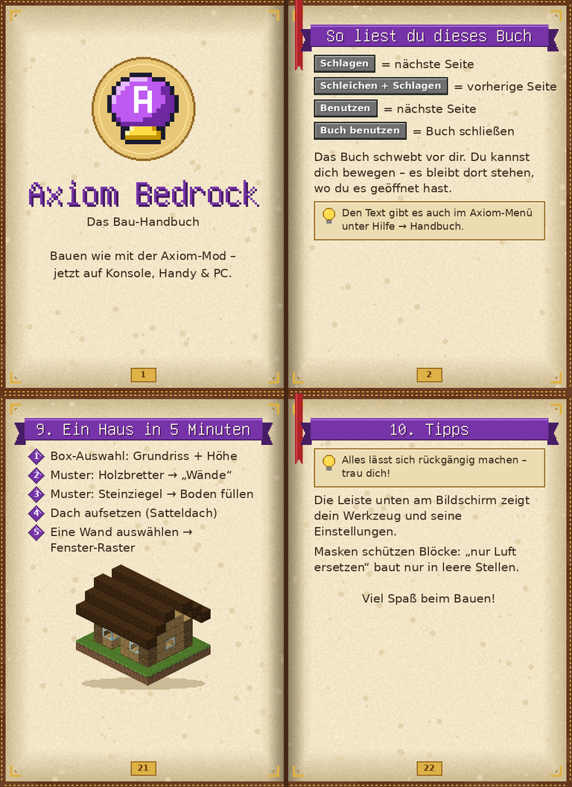

# Axiom Bedrock

Ein Add-on für **Minecraft Bedrock Edition** (Konsole, Handy, PC), das die wichtigsten Bauwerkzeuge der Java-Mod
[Axiom](https://axiom.moulberry.com/) nachbildet: Auswahl-Werkzeuge, Formen, Modellieren, Malen, Terrain,
Zwischenablage mit Drehen/Spiegeln, Blaupausen, Rückgängig/Wiederherstellen, Symmetrie und vieles mehr.

Alles wird mit **Werkzeug-Items** und **Menüs** bedient, damit es auch mit dem **Controller** gut funktioniert.

> **Download:** [`dist/AxiomBedrock.mcaddon`](dist/AxiomBedrock.mcaddon) (enthält Verhaltens- und Ressourcenpaket)

---

## Installation

### Auf Handy oder PC (Windows)
1. `AxiomBedrock.mcaddon` herunterladen und öffnen → Minecraft importiert beide Pakete automatisch.
2. Neue Welt erstellen (oder bestehende bearbeiten):
   - **Kreativmodus** empfohlen
   - Unter **Verhaltenspakete** → „Axiom Bedrock (Verhalten)“ aktivieren (das Ressourcenpaket wird automatisch mit aktiviert)
   - **Experimente müssen NICHT eingeschaltet werden** – das Add-on nutzt nur stabile Schnittstellen.
3. Welt starten. Du bekommst automatisch das **Axiom-Menü**-Item.

### Auf Konsole (Xbox, PlayStation, Switch)
Konsolen erlauben keinen direkten Import von Add-on-Dateien. Der offizielle Weg ist ein **Realm**:

1. Auf einem **Handy/Tablet oder PC** mit Minecraft (gleiches Microsoft-Konto) das Add-on wie oben importieren
   und eine Welt mit aktiviertem Verhaltenspaket erstellen. Einmal kurz betreten.
2. In Minecraft: **Spielen → Realms → dein Realm bearbeiten (Stift) → Welt ersetzen** → die eben erstellte Welt wählen.
3. Auf der Konsole dem Realm beitreten – die Werkzeuge sind da.

Alternativen: Die Welt auf dem Handy/PC hosten und von der Konsole als Freund beitreten (benötigt ein zweites Konto),
oder einen eigenen Bedrock-Server mit dem Add-on betreiben.

---

## Schnellstart

> **Neu: Editor-Modus (wie bei Axiom).** Axiom-Menü → „Editor-Modus an“ (oder `/axiom:editor`): Deine Hotbar wird zur
> Werkzeugleiste – Tasten **1–8** = Werkzeuge, **9** = **Übersicht** mit allen Werkzeugen (mit Bildern, nach Gruppen)
> und den wichtigsten Aktionen. In der Übersicht ein Werkzeug antippen = es auf die gewählte Taste legen. Dort gibt es
> auch die **Vogelperspektive** (Kamera schaut von oben auf deinen Bau). Ausschalten gibt dir deine Hotbar zurück.
> Ideal mit Tastatur & Maus: Rechtsklick = Benutzen, Linksklick = Schlagen, Shift = Schleichen.

> **Neu: das Axiom-Handbuch.** Beim Betreten bekommst du ein Buch. Benutze es – dann klappt ein großes 3D-Buch vor
> dir auf, das alle Werkzeuge mit Bildern erklärt. **Schlagen** oder **Benutzen** auf das Buch = umblättern,
> **Schleichen + Schlagen** = zurück, das Buch-Item nochmal benutzen = schließen. Ideal, um es Freunden zu zeigen.



1. **Axiom-Menü** benutzen → **Werkzeuge holen → Alle Werkzeuge**.
2. Mit der **Box-Auswahl** zweimal auf Blöcke zielen und benutzen → Bereich ist markiert (Partikel-Rahmen).
3. Mit einem Axiom-Werkzeug einen Block **schlagen** → dieser Block wird dein aktiver Block (Pipette).
4. **Axiom-Menü → Auswahl bearbeiten → Füllen**.
5. Fehler gemacht? **Rückgängig**-Werkzeug benutzen (Schleichen + Benutzen = Wiederherstellen).

### Steuerung (für alle Werkzeuge gleich)

| Aktion | Controller | Wirkung |
|---|---|---|
| **Benutzen** | linker Trigger (LT / L2 / ZL) | Hauptaktion des Werkzeugs – Pinsel-Werkzeuge: **gedrückt halten** |
| **Schleichen + Benutzen** | Stick drücken + LT | Einstellungen des Werkzeugs |
| **Schlagen** | rechter Trigger (RT / R2 / ZR) | Pipette (Block übernehmen) oder Zusatzaktion |

Werkzeuge haben eine **sehr große Reichweite** (Standard 160 Blöcke, einstellbar bis 512).
In der Aktionsleiste siehst du immer das aktuelle Werkzeug und seine Einstellungen.

---

## Werkzeuge

| Werkzeug | Was es macht |
|---|---|
| **Axiom-Menü** | Hauptmenü: Werkzeuge, Block/Muster, Maske, Auswahl, Zwischenablage, Verlauf, Fähigkeiten, Symmetrie, Ansichten, Welt, Hotbar-Sätze, Hilfe |
| **Box-Auswahl** | Ecke 1 und Ecke 2 setzen (Benutzen). Schlagen setzt Ecke 1 auf kurze Distanz. |
| **Magische Auswahl** | Wählt verbundene Blöcke automatisch: gleicher Blocktyp, sichtbare Oberfläche, oder alle festen Blöcke. |
| **Pinsel-Auswahl** | Freihand-Auswahl: mit dem Pinsel über Blöcke „malen“. |
| **Baumeister** | Fügt die Zwischenablage am Blickziel ein (mit Vorschau-Rahmen). Schlagen = 90° drehen. Einstellungen: Spiegeln, Luft mit einfügen, Kreaturen, Höhenversatz. |
| **Formen** | Kugel/Ellipsoid, Halbkugel, Quader, Zylinder, Kegel, Pyramide, Torus, Bogen, Prisma (Dach), Spirale (Wendelrampe, Steigung einstellbar), Säule mit Sockel & Kapitell (bis zum Boden), **Wendeltreppe** aus echten Treppenblöcken um eine Mittelsäule, **Zwiebelturm** (bauchige Kuppel mit Spitze), **Spitzbogen** (gotisches Fenster/Tor – mit Material „Ausschneiden“ direkt in eine Wand schneiden), **Rosettenfenster** (Maßwerk-Rad mit Ring, Nabe und Speichen, Anzahl über den Ecken-Regler), **Tonnengewölbe** und **Kreuzgewölbe** (gewölbte Decke – am besten mit „In die Auswahl einpassen“ in den Deckenbereich einer Halle), **Turm** (Rundturm mit Boden, Tür, Schießscharten, Zinnen und Spitzdach aus Muster 2), **Leuchtturm** (nach oben schmaler, gestreift aus Muster 1/2, Galerie mit Geländer, Glas-Laterne mit Seelaterne, Dach) – die Wendeltreppe bekommt auf Wunsch ein **Geländer** (Holz → passender Zaun, sonst Eisengitter), Keil/Rampe, Dreieck-Pyramide (Tetraeder), Doppelpyramide (Oktaeder), Vieleck-Turm (3–12 Ecken), Stufenpyramide, Rohr/Walze (liegend), Scheibe, Kegelstumpf, Stern, Herz und Kreuz. Jede Form lässt sich in 15°-Schritten **drehen, nach vorne kippen und zur Seite neigen** (z.B. schräger Zylinder oder liegender Kegel); mit Platzierung **„In die Auswahl einpassen“** füllt die Form genau die aktuelle Auswahl aus (Kuppel, Bogen, Keil stehen dabei auf dem Boden der Auswahl). Mit **„Von Punkt A nach Punkt B ziehen“** legst du Zylinder, Kegel, Pyramide, Quader usw. zwischen zwei Punkte (auch schräg – z.B. Stützbalken oder ein Kegel als Turmspitze, Schlagen verwirft Punkt A). **Hohl** lässt sich mit offenem Boden, offenem Deckel oder beidem (Röhre) bauen, **Nur Kanten** baut ein Drahtgitter (ideal für Quader, Pyramide, Prisma). **Material:** ein Muster, **Verlauf** von unten (Muster 1) nach oben (Muster 2) oder **Rand** aus Muster 2 mit Füllung aus Muster 1, **Streifen** (waagerecht/senkrecht) oder **Schachbrett** mit einstellbarer Breite, **Fachwerk** (Balken, Ständer und Andreaskreuze aus Muster 2, Felder aus Muster 1 – z.B. mit „In die Auswahl einpassen“ auf eine Wand), **Rippen** (senkrechte Bänder rundherum, Anzahl über den Ecken-Regler – z.B. Kuppel mit goldenen Rippen) – oder **Ausschneiden**: die Form wird zu Luft (Fensteröffnung in einer Kuppel, Tunnel durch einen Berg, z.B. mit „Von A nach B“). **Lieblingsformen:** Einstellungen unter einem Namen speichern (bis 12) und per Schleichen + Benutzen mit einem Tipp wieder wählen. Ein **Partikel-Umriss** zeigt die Form vor dem Bauen am Blickziel; im **Vorschau-Modus** merkt sich der 1. Klick die Stelle und der 2. Klick baut (Schlagen bricht ab) – massiv oder hohl, mittig oder auf dem Boden, auf Wunsch quer zur Blickrichtung gedreht. |
| **Modellieren** | Aufbauen, Abtragen, Glätten, Schmelzen/Erodieren, Auffüllen, Felsen, Aufrauen, Verzerren, Zerbrechen – optional mit unregelmäßigem Rand. |
| **Maler** | Oberfläche bemalen, nur Oberseite, alles ersetzen, Rauschen-Maler (2 Muster), Höhenverlauf, nach Neigung (flach Gras, steil Stein), Streuen (z.B. Gras & Blumen verteilen), Flutfüllung (See/Becken ab Blickziel füllen), Säubern (Pflanzen/Wasser weg). |
| **Terrain** | Gelände anheben, absenken, einebnen, glätten, Hügel, Terrassen, **Terrassenfelder** (ganz ebene Stufen mit Stützmauern, Mauerblock wählbar) – mit **Pinselform** Weich, Spitz (Gipfel), Rund (Kuppel), Plateau (flach oben) oder Hart. Dazu Stempel für **Berg**, **Krater**, **Vulkan**, **Hochplateau**, **Insel** (mit Sandstrand), **Schlucht** (in Blickrichtung), **Düne** (Sand, flach vorne & steil hinten), **Schneegipfel** (Gras, Fels, Schnee), **Klippe** (Felswand quer vor dir), **Felsbogen** (natürlicher Steinbogen, Füße bis zum Boden), **Höhleneingang** (Stollen in Blickrichtung in den Hang), **Gletscher** (Eiszunge in Blickrichtung, oben Schnee, vorne blankes Eis), **Eisberg** (auf Wasser zielen – Eisgipfel über und großer Eiskörper unter Wasser) und **Wasserfall** (auf eine Felswand zielen) – je ein Klick – sowie **Treppen an Stufenkanten** (setzt passende Treppen oder wahlweise Stufen-Platten vor 1-Block-Stufen). **Biom-Malen** (Schalter im Menü) färbt beim Terraformen automatisch passend: Gras mit Erde darunter, Sand am Wasser, Stein/Andesit an steilen Hängen, Kies an mittleren Hängen und Schnee über der einstellbaren Schneegrenze; Modus „Nur Oberfläche anpassen“ färbt ohne die Höhe zu ändern. Bauwerke bleiben unberührt. **Stempel einstellbar:** Zackigkeit (0 = glatt), Drehung (in 15°-Schritten, 0 = Blickrichtung) und Streckung (bis dreimal so lang, z.B. Bergkamm oder lange Insel); ein Partikel-Umriss zeigt Grundriss und Längsachse vor dem Setzen. **Bepflanzen:** Bäume (Eiche, Birke, Fichte – hoch oben nur Fichten), Büsche, Gras und Blumen auf Gras/Erde im Radius; Art wählbar (Gemischt, Laubwald, Nadelwald, Wiese), Stärke = Dichte, Blätter zerfallen nicht. **See:** in eine Mulde zielen – sie wird bis genau zum niedrigsten Rand mit Wasser gefüllt (Grund wird Sand, tiefe Stellen Kies; nichts läuft über). **Erosion:** „Regen“ lässt Tropfen den Hang hinunterlaufen, die Rinnen auswaschen und den Boden in Senken ablagern; „Wind/Schmelzen“ rundet Spitzen und Grate ab und füllt kleine Löcher. |
| **Extrudieren** | Zieht eine ganze Fläche verbundener Blöcke um eine Schicht heraus bzw. drückt sie hinein. |
| **Pfad** | Punkte setzen und als gerade Linie oder weiche Kurve bauen. Im Menü außerdem **Lasso** (Fläche innerhalb der Punkte auswählen), **Brücke** (Belag mit Bogen, Geländer und Stützpfeilern) und **Fluss** (Flussbett mit Wasser entlang der Punkte, Breite/Tiefe/Bett-Block einstellbar). – rund (auch hohl als Röhre) oder flach als Straße/Rampe mit Unterbau bis zum Boden.  Flüsse bekommen auf Wunsch ein **Sandufer**. **Trampelpfad** entlang der Punkte: folgt dem Boden (Höhe der Punkte egal), als Erdweg, Kiesweg oder bemoostes Pflaster mit ausgefransten Rändern, Gras auf dem Weg verschwindet. **Bogengang (Arkaden)** entlang der Punkte: Säulen (Muster 2) im einstellbaren Abstand, dazwischen Rundbögen und ein Balken (Muster 1), Höhe und Wandtiefe einstellbar. **Küste** entlang der Punkte: die Punkte sind die Uferlinie, auf der Meerseite wird das Wasser nach außen tiefer (Sand, draußen Kies), an Land entsteht ein **Sandstrand** oder eine **Felsklippe** (Höhe einstellbar). **Hügelkette** entlang der Punkte (Pfad-Menü oder Terrain-Modus): Kamm folgt der Kurve, Enden laufen flach aus. |
| **Text** | Schreibt Text aus Blöcken – an eine Wand oder flach auf den Boden, in bis zu 8-facher Größe. Modus **Pixel-Art**: Zeilen aus Zeichen (z.B. `rr.rr/rrrrr`) plus Legende (`r=red_wool`) werden zu einem Block-Bild – mit fertigen Vorlagen (Herz, Creeper, Schwert, Smiley, Stern, Pfeil, Haus). |
| **Lineal** | Misst Abstände und Größen zwischen zwei Punkten. |
| **Blockzustand-Editor** | Ändert Zustände eines Blocks (Richtung, Achse, offen/zu, Stufe …). Schlagen = drehen. |
| **Bulldozer** | Baut Blöcke auf große Entfernung sofort ab (einzeln oder im Radius). |
| **Kreaturen** | Kreaturen, Rüstungsständer & Co. im Blick an-/abwählen (oder alle rund ums Blickziel bzw. in der Block-Auswahl) und dann verschieben, zum Blickziel setzen, zu dir holen, drehen, benennen, kopieren oder löschen. Schlagen = Auswahl leeren. |
| **Axiom-Handbuch** | 3D-Buch mit allen Erklärungen und Bildern, das vor dir aufklappt (auch als Text im Hilfe-Menü). |
| **Rückgängig** | Benutzen = Rückgängig, Schleichen + Benutzen = Wiederherstellen (40 Schritte pro Spieler). Im Menü „Verlauf“ kann man gezielt zu einem Schritt zurückspringen. |

### Auswahl bearbeiten (im Axiom-Menü)
Füllen · Ersetzen · Leeren · Hohlräume füllen · Dach aufsetzen (Sattel-/Walmdach) · Fenster-Raster · Verlauf (Muster 1 → 2) · **Landschaft erzeugen** (Box mit Hügeln, Tälern, Seen bis zur Meereshöhe füllen – Größe, Bergeshöhe, Meereshöhe, Feinheit einstellbar) · **Inselgruppe im Meer erzeugen** (Meer mit mehreren Inseln, Stränden, Wiesen und Gipfeln) · **Höhlen-Netz graben** (verzweigte Gänge mit Kammern in einer Auswahl – Anzahl, Breite, Kammern einstellbar) · Ausdünnen (Ruinen) · Wasser ablassen · Mit Wasser füllen · Wände · Umriss · Aushöhlen · Überziehen · Natürlich machen · Glätten ·
Kopieren · Ausschneiden · Stapeln · Array (Versatz + Drehung pro Kopie, z.B. Wendeltreppen) · Verschieben ·
Drehen (90/180/270°) · Spiegeln · Gespiegelte Kopie daneben (symmetrische Gebäudeflügel) · Zwischenablage verstreuen (z.B. Baum-Blaupause als Wald) · Analysieren (Blöcke zählen) ·
Auswahl erweitern/verkleinern/verschieben · in 3D aufblasen/schrumpfen · auf Oberfläche begrenzen · per Koordinaten · Auswahl aufheben.

Auswahl-Modus (in den Auswahl-Werkzeugen): **Ersetzen**, **Hinzufügen (+)** oder **Entfernen (−)** – so lassen
sich Auswahlen wie bei Axiom kombinieren.

### Muster (aktiver Block)
- **Pipette:** mit einem Axiom-Werkzeug auf einen Block schlagen (übernimmt auch Zustände wie Holzachse).
- Aus dem Inventar wählen, **Hotbar-Blöcke als Mischung**, oder als Text: `3*stone, andesite, oak_log[pillar_axis=x]`.
- **Paletten:** Muster unter einem Namen speichern und später mit einem Klick wieder laden.

### Maske
Legt fest, welche Blöcke Werkzeuge verändern dürfen: alles, nur Luft/Pflanzen, nur feste Blöcke,
nur bestimmte Blöcke oder alles außer bestimmten Blöcken.

### Fähigkeiten
- **Reichweite** der Werkzeuge (8–512 Blöcke)
- **Weit platzieren:** normale Blöcke auf große Entfernung setzen
- **Engel-Platzierung:** Blöcke frei in die Luft setzen
- **Ersetzen-Modus:** angeklickten Block ersetzen statt daneben bauen
- **Nachtsicht**, **Durch Wände fliegen** (Zuschauer-Modus)
- **Nur Operatoren** dürfen Axiom benutzen (für Realms mit Freunden)

Auch mit Fähigkeiten gesetzte Blöcke lassen sich rückgängig machen.

### Symmetrie
Spiegelt alles, was Werkzeuge bauen – und auch normales Bauen und Abbauen – an einer X- und/oder Z-Achse.

### Zwischenablage & Blaupausen
Kopien bleiben auch nach einem Neustart der Welt erhalten. Blaupausen werden in der Welt gespeichert und können
von allen Spielern geladen werden. Die Blaupausen-Liste zeigt Größe, Ersteller und Datum; Blaupausen lassen sich
laden, umbenennen und löschen – und vorher als **Vorschau-Rahmen** am Blickziel anzeigen. Eine Auswahl kann auch
direkt als Blaupause gespeichert werden (ohne Umweg über Kopieren).

### Ansichten
Standpunkte mit Blickrichtung speichern und später per Menü wieder hinspringen (wie Axioms „Views“).

### Anmerkungen
Schwebende Bau-Notizen (farbiger Text), die alle Spieler sehen – z.B. „Hier kommt das Tor hin“. Im Axiom-Menü
setzen, bearbeiten, hinfliegen, versetzen oder löschen. Außerdem lassen sich farbige **Linien** speichern: mit dem
Lineal zwei Punkte messen, dann im Anmerkungen-Menü „Linie aus der letzten Lineal-Messung“ (sichtbar, solange man
ein Axiom-Werkzeug hält).

### Welt
Tageszeit, Wetter, Tageszyklus/Wetterwechsel, Mob-Spawning, Feuer, Mob-Griefing, Zufalls-Tick, Koordinaten.

### Hotbar-Sätze
Wie bei Axiom: bis zu 9 Hotbars speichern und mit einem Klick wechseln.

### Chat-Befehle (Handy/PC)
`/axiom:menu` · `/axiom:editor` · `/axiom:overview` · `/axiom:undo` · `/axiom:redo` · `/axiom:tools` · `/axiom:guide`

---

## Unterschiede zu Axiom (Java)

Bedrock erlaubt Add-ons keine eigenen 3D-Editor-Oberflächen, Tastenkürzel oder Kamera-Steuerung. Deshalb:
- Statt Editor-Fenster gibt es **Menüs** (Formulare) und **Werkzeug-Items**.
- Statt Vorschau-Hologrammen gibt es **Partikel-Rahmen** (Auswahl, Einfüge-Vorschau, Pfadpunkte, Symmetrieachse).
- Biome malen ist mit den stabilen Schnittstellen (noch) nicht möglich.
- Beim Einfügen mit Drehen **und** Spiegeln gleichzeitig kann es bei sehr großen Kopien (> 64 Blöcke) zu
  Versatz zwischen den Teilstücken kommen – bitte melden, falls das auftritt.

Die weitere Planung steht in [ROADMAP.md](ROADMAP.md).

---

## Für Entwickler

```bash
npm install          # Typdefinitionen + TypeScript
npm run check        # Typprüfung (JavaScript mit JSDoc, strict)
npm test             # Rundum-Test aller Werkzeuge gegen eine API-Attrappe (inkl. Rückgängig/Wiederherstellen)
pip install pillow
npm run build        # erzeugt Items, Texturen, Sprachdateien und dist/AxiomBedrock.mcaddon
```

Aufbau:
- `packs/AxiomBP/scripts/` – Skript-Code (`@minecraft/server` 2.4.0, `@minecraft/server-ui` 2.0.0, Minecraft ≥ 1.21.120)
  - `core/` – Auswahl, Muster/Maske, Bearbeitungs-Engine, Verlauf, Zwischenablage, Auswahl-Operationen
  - `tools/` – ein Modul pro Werkzeug
  - `ui/` – Menüs
- `packs/AxiomRP/` – Texturen, Partikel, Sprachdateien
- `tools/build.py`, `tools/icons.py` – Generator (Icons als Pixel-Art im Code)
- `tests/` – Test-Attrappe von `@minecraft/server` und Testlauf
